<div align="center">



# M4ZK1PL4Y

### Private messaging. Device-first identity. Built to connect.

[](https://github.com/jambudio336-hue/m4zk1pl4y-chat/actions/workflows/build-apk.yml)
[](https://expo.dev/)
[](https://reactnative.dev/)
[](https://supabase.com/)
[](LICENCE)

**[Source code](https://github.com/jambudio336-hue/m4zk1pl4y-chat) · [Builds](https://github.com/jambudio336-hue/m4zk1pl4y-chat/actions) · [Report an issue](https://github.com/jambudio336-hue/m4zk1pl4y-chat/issues)**

</div>

---

## About

M4ZK1PL4Y is an experimental, device-first messaging application. It is designed around an identity generated on the user's device, with private signing and encryption keys intended to remain local.

> **Project status:** Active development. The APK build pipeline and API health endpoint have been exercised, but complete multi-device registration, messaging, media delivery, realtime updates, push notifications, and calling still require end-to-end verification. Do not treat every listed capability as production-ready.

## Product direction

| Area | Direction |
| --- | --- |
| Identity | Device-generated account identity; no phone number in the onboarding flow |
| Key custody | Private keys are stored locally using Expo SecureStore |
| Authentication | Signed server challenge and session token |
| Messaging | Encrypted message payloads; server should only store ciphertext |
| Backend | Supabase Edge Function and Postgres |
| Android | Expo SDK 54 / React Native 0.81 |

## Architecture

```text
┌──────────────────────────────┐
│       Android application    │
│  Expo Router · React Native  │
│                              │
│ SecureStore · Device keys    │
│ Chat UI · Stories · Calls    │
└──────────────┬───────────────┘
               │ HTTPS API
               ▼
┌──────────────────────────────┐
│      Supabase Edge Function  │
│           m4zk-api           │
└──────────────┬───────────────┘
               │ service role
               ▼
┌──────────────────────────────┐
│       Supabase Postgres      │
│ m4zk_users · messages · ...  │
└──────────────────────────────┘
```

The current mobile client also contains a Socket.IO integration from the original server architecture. Persistent Socket.IO connections are not provided by Supabase Edge Functions; realtime transport needs a compatible service or a Supabase Realtime implementation before live chat and call signaling can be considered operational.

## Repository layout

```text
apps/
  mobile/                  Expo React Native application
    app/                   Expo Router screens
    components/            Shared UI components
    lib/                   API, identity, socket, theme
    assets/                Bundled media assets
  server/                  Original Express + Socket.IO server
supabase/
  functions/m4zk-api/      Supabase API function
  migrations/              Database migrations
docs/                      Architecture notes
assets/                    Repository artwork
.github/workflows/         Android release build
```

## Getting started

### Requirements

- Node.js 20+
- npm
- Android Studio / Android SDK for local Android builds
- A Supabase project for the hosted API

### Install dependencies

```bash
npm install --legacy-peer-deps
```

### Configure the mobile API

Set the public API base URL before starting the Expo app:

```bash
EXPO_PUBLIC_API_URL=https://YOUR_PROJECT.supabase.co/functions/v1/m4zk-api
```

Do not put a Supabase service-role key, JWT signing secret, or any other server secret in the mobile app or in `EXPO_PUBLIC_*` variables.

### Run the mobile app

```bash
npm run dev:mobile
```

### Run the original server (development only)

```bash
cp apps/server/.env.example apps/server/.env
npm run dev:server
```

The original Express/SQLite/Socket.IO server is a separate development architecture. It is not automatically deployed by the Supabase Edge Function workflow.

## Build an Android APK

The repository includes a GitHub Actions workflow:

1. Open **Actions → Build Release APK**.
2. Select **Run workflow** or push to `main`.
3. Wait for the build job to complete.
4. Download the APK artifact from the completed workflow run.

Workflow: [Build Release APK](https://github.com/jambudio336-hue/m4zk1pl4y-chat/actions/workflows/build-apk.yml)

The workflow accepts an optional `M4ZK_API_URL` repository variable and otherwise uses the configured public Supabase function URL. Release signing secrets are optional for test builds; configure Android keystore secrets before distributing a production release.

## Security notes

- Never commit private keys, service-role keys, signing keystores, passwords, or production secrets.
- A public API URL is not a secret; server credentials are.
- Client-side encryption claims must be validated with cryptographic tests and independent review.
- Device-only keys mean account recovery is not possible unless a deliberate, secure recovery mechanism is designed.
- Use test accounts and non-sensitive data while the project is under development.

## Current verification checklist

- [x] GitHub Actions Android APK workflow
- [x] Supabase API health endpoint
- [ ] Registration and login end-to-end
- [ ] Two-device message send/receive
- [ ] Profile photo upload and public/private visibility rules
- [ ] Stories upload and playback
- [ ] Realtime delivery and read receipts
- [ ] Push notifications
- [ ] WebRTC call signaling and TURN connectivity
- [ ] Release signing and upgrade-path testing

## Contributing

Issues and pull requests are welcome. Please include device details, Android version, build/run link, reproducible steps, and sanitized logs when reporting a bug. Never attach secrets or private user data.

## License

See [LICENCE](LICENCE).
